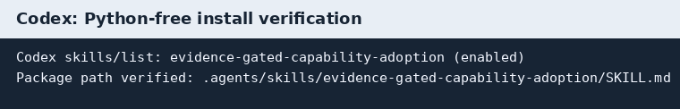
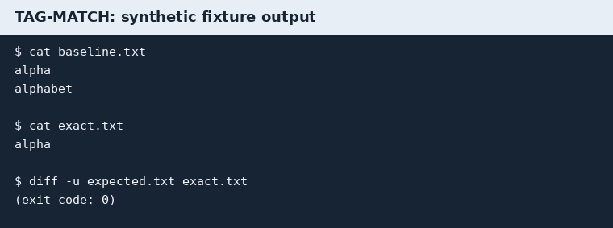

# Your first EGCA program

Start in a throwaway Git repository with at least one local commit and no remote
required. This walkthrough uses a synthetic example:
could whole-line matching replace substring matching for a list of exact tags?
It records a proposal and reproducible evidence, not a production change. Use
the [README install steps](https://github.com/sundayj/EvidenceGatedCapabilityAdoption#install-in-codex-no-python-required)
if the skill has not been copied into place.

In Codex the skill should appear by name. This is the actual local discovery
check output, rendered for readability; the composer UI may look different.



## 1. Invoke the skill and pick one place to save state

In Codex, select the skill in the composer and send this prompt:

```text
$evidence-gated-capability-adoption
Start a practice program TAG-MATCH for this scratch repository. Investigate
whether whole-line matching would prevent lookalike tag matches. Compare
grep -F versus grep -Fx on a tiny synthetic fixture. Use Git-tracked Markdown
at docs/egca/tag-match/ as the one authoritative tracker.

Record the current baseline and the EGCA manifest version and exact source
revision I installed: <paste the EGCA source commit SHA here>. Create the
local feature/egca-tag-match integration branch if absent. Record C-001,
the investigation, and proposed experiment E-001 with its success and
rejection criteria. Use a versioned criteria identifier. Do not commit,
push, merge, deploy, execute the proposed experiment, or grant authority.
Then read back the tracker and show its path, IDs, and status.
```

Expected checkpoint (wording and paths other than the tracker may vary):

```text
Program: TAG-MATCH
Tracker: docs/egca/tag-match/
Integration branch: feature/egca-tag-match
C-001: Investigating
E-001: Planned
Decision: not recorded
```

The tracker should also contain the target baseline, governing methodology
version and source revision, source observations, and a hypothesis that can
fail. A printed summary alone is not proof that the records were saved.

## 2. Try the fixture without making a lifecycle decision

Use a POSIX shell (Git Bash on Windows is one option) in the scratch repo:

```sh
printf 'alpha\nalphabet\nbeta\n' > tags.txt
printf 'alpha\n' > expected.txt
grep -F alpha tags.txt > baseline.txt
grep -Fx alpha tags.txt > exact.txt
cat baseline.txt
cat exact.txt
diff -u expected.txt exact.txt
```

Expected: the first `cat` prints `alpha` and `alphabet`; the second prints
only `alpha`; `diff` prints nothing and exits 0. If whole-line matching
returns another line or loses `alpha`, the candidate fails the fixture
criterion. If commands fail for another reason, record the error rather
than marking the criterion passed.

The actual fixture output, rendered below, shows the baseline false positive
and the exact-match check passing.



Back in Codex:

```text
$evidence-gated-capability-adoption
Resume TAG-MATCH from docs/egca/tag-match/. Inspect tags.txt, expected.txt,
baseline.txt and exact.txt. Attach the command results as proposed evidence
for E-001, with its producer, scope (three synthetic lines, case-sensitive
matching with the grep implementation actually used), and criteria revision.
Do not turn this into an authoritative lifecycle transition, decision, or
claim of independent verification. Show what you recorded and the next gate.
```

Expected: the evidence records the false positive in the baseline and that
the fixture output equals the expectation. The evidence is limited to this
fixture. No Adopt/Adapt/Reject/Repeat decision or merge is implied; E-001
remains Planned until a valid transition is admitted. A real experiment
needs the applicable versioned mandate and evidence, including separate
provenance when independence is required. See the
[experiment record](../templates/experiment-template.md).

## 3. Verify that another session can resume

Open a fresh Codex session in the same project and send:

```text
$evidence-gated-capability-adoption
Read only: resume TAG-MATCH from docs/egca/tag-match/. Give me C-001 and
E-001, its saved evidence reference, criteria revision, status, and
governing version/revision. Do not create or update any record.
```

Expected: the same IDs, persisted evidence and governing pin, not a new
tracker. Follow the evidence reference and inspect the fixture output. If
it cannot read the tracker or the evidence, the persistence check has not
passed. For repeatable handoff across machines, keep the synthetic evidence
with the tracker and commit both only if authorized.

## 4. Use a different storage backend

Choose the backend in the first prompt, before creating the tracker. Reuse
an existing tracker where possible. EGCA does not install storage
connectors or define a universal config file. A path, document URL,
workbook/tab, or approved database workspace identifies the state; the host
supplies access and any connector.

| Backend | Example instruction to replace the Markdown line | Verify before using it |
| --- | --- | --- |
| Git-tracked Markdown (default for the tutorial) | Use only `docs/egca/tag-match/` on the integration branch. Link files by record ID. | Verify the branch and relative links. To resume on another machine, the permitted commit/transfer must exist first. |
| Google Docs | Use this **existing, approved** document: <document URL>. Use an overview and sections labeled by stable ID. | Resolve the exact document; read back the added section by ID. Preserve unrelated edits and version history. |
| Google Sheets or another spreadsheet | Use this **existing, approved** workbook: <workbook URL>. Map records to tabs and join by ID, not by row number. | Verify the exact workbook/tab and one read-back by ID after sorting or filtering. Retain prior decisions and link evidence. |
| An existing database | Use the **approved sandbox only**: <connector, database/schema or API workspace>. Map program, candidate, experiment, decision, and evidence references to existing records. | Resolve the exact environment, use scoped access, confirm safe stored revisions and no duplicate IDs on retry. Use transactional writes or equivalent conflict guards where supported. |
| Other durable store (for example, an issue tracker) | Use <project and tracker location>. Map records to linked issues or supported objects with stable IDs. | Verify links, access from a fresh session, permissions, and revision/history support. |

For any alternative, replace the Markdown location in the subsequent prompts
with the same canonical target. Use the [tracker schema](../templates/tracker-schema.md)
to map the overview, candidate backlog, investigations, experiments, evidence,
and decisions. Use a linked, append-only ledger when required. Keep rejected
results, the methodology pin, and evidence provenance. Prefer references over
copying private evidence into shared stores. Do not paste credentials into
prompts or trackers.

```text
Use [backend + exact location] as TAG-MATCH's only source of truth.
Resolve it read-only first and show the record mapping. If I have authorized
writes to this practice target, save C-001 and E-001 there and read them
back by ID, preserving unrelated records. If access or safe writes are
missing, name the blocker and do not create a fallback tracker.
```

Run the fresh-session check from step 3 against that target. An accessible
document, spreadsheet row, or database record stores evidence; it does not
by itself satisfy a transition mandate. Keep this exercise in a disposable
target and do not set up new infrastructure just to try the skill.
